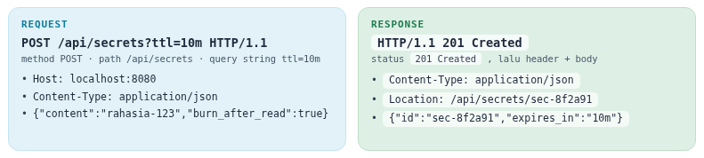

Golang sendiri memiliki package bawaan bernama http yang memudahkan kita untuk membuat http server dan REST-API. 

## 1. Dasar HTTP = Protokol Request Response

Client (browser, aplikasi mobile, curl) mengirim **Request**; server membalas dengan **Response**.



### HTTP Methods

| Method | Arti | Contoh | Status Sukses Umum |
| :--- | :--- | :--- | :--- |
| `GET` | Ambil data | `GET /api/buku/1` | `200 OK` |
| `POST` | Buat data baru | `POST /api/buku` | `201 Created` |
| `PUT` | Ganti seluruh data | `PUT /api/buku/1` | `200 OK` |
| `PATCH` | Ubah sebagian data | `PATCH /api/buku/1` | `200 OK` |
| `DELETE` | Hapus data | `DELETE /api/buku/1` | `204 No Content` |

### Kelompok Status Code

| Kode | Arti | Contoh |
| :--- | :--- | :--- |
| **`2xx`** | Sukses | `200 OK`, `201 Created`, `204 No Content` |
| **`3xx`** | Redirect | `301 Moved Permanently`, `304 Not Modified` |
| **`4xx`** | Kesalahan client | `400 Bad Request`, `401 Unauthorized`, `403 Forbidden`, `404 Not Found`, `405 Method Not Allowed`, `409 Conflict`, `422 Unprocessable Entity`, `429 Too Many Requests` |
| **`5xx`** | Kesalahan server | `500 Internal Server Error`, `502 Bad Gateway`, `503 Service Unavailable`, `504 Gateway Timeout` |

## 2. Server Pertama dengan net/http

mari kita lihat package bawaan go untuk http

```golang
package main

import (
	"fmt"
	"log"
	"net/http"
)

func main() {
	http.HandleFunc("/", func(w http.ResponseWriter, r *http.Request) {
		fmt.Fprintf(w, "Halo dari Go! Kamu mengakses %s %s\n", r.Method, r.URL.Path)
	})

	http.HandleFunc("/salam", func(w http.ResponseWriter, r *http.Request) {
		nama := r.URL.Query().Get("nama") // query string ?nama=...
		if nama == "" {
			nama = "tamu"
		}
		fmt.Fprintf(w, "Selamat datang, %s!\n", nama)
	})

	log.Println("server jalan di http://localhost:8080")
	log.Fatal(http.ListenAndServe(":8080", nil)) // nil = pakai http.DefaultServeMux
}

```


