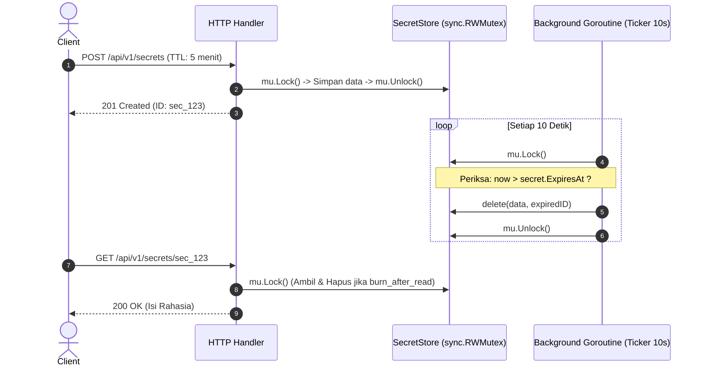

# PRD: Ephemeral Secret Sharing API (Mini "Privnote")

> **Dokumen Spesifikasi Produk & Arsitektur Teknis**  
> **Status:** Draft / Siap Implementasi  
> **Target Rilis:** Portfolio-Ready Project  
> **Tech Stack:** Go Standard Library (`net/http`, `sync`, `crypto/rand`, `time`) — *Zero External Dependencies*

---

## 1. Pendahuluan & Latar Belakang (Overview)

### 1.1 Problem Statement
Berbagi data sensitif (seperti password sementara, API key, koneksi database, atau token rahasia) melalui aplikasi pesan instan (Slack, Discord, WhatsApp) meninggalkan jejak digital permanen di log percakapan. Jika akun terkompromi di kemudian hari, data rahasia tersebut tetap bisa dibaca.

### 1.2 Solusi
Membangun **RESTful API Ephemeral Secret Sharing** yang memungkinkan pengguna menyimpan data rahasia sementara di dalam memori server (*in-memory*). Rahasia tersebut memiliki masa kedaluwarsa (*Time-To-Live / TTL*) dan opsi untuk langsung hancur/terhapus seketika setelah pertama kali dibaca (*Burn After Reading*).

### 1.3 Kenapa Proyek Ini Kuat untuk Portofolio?
* **Menguasai Standard Library Go:** Dibangun murni dengan `net/http` (tanpa framework pihak ketiga seperti Gin/Fiber), mendemonstrasikan pemahaman mendalam tentang HTTP request/response lifecycle.
* **Concurrency-Safe:** Menggunakan `sync.RWMutex` untuk menangani pembacaan (*read*) dan penulisan (*write*) simultan tanpa *data race*.
* **Background Worker (Goroutine):** Menggunakan `time.Ticker` dalam goroutine terpisah untuk membersihkan data kedaluwarsa secara berkala guna mencegah *memory leak*.
* **Arsitektur Bersih:** Struktur kode *decoupled* yang siap diintegrasikan dengan database persisten (Redis/PostgreSQL) di masa depan melalui *repository interface*.

---

## 2. Kebutuhan Fungsional (Functional Requirements)

| ID | Fitur | Deskripsi | Prioritas |
| :--- | :--- | :--- | :--- |
| **FR-01** | **Create Secret** | Pengguna dapat mengirim secret teks dengan TTL (misal: `5m`, `1h`, `24h`) dan opsi `burn_after_read`. Mengembalikan URL/ID unik rahasia. | P0 (Must Have) |
| **FR-02** | **Read Secret** | Pengguna dapat mengambil isi secret menggunakan ID unik. Jika `burn_after_read = true`, data langsung dihapus dari memory saat itu juga. | P0 (Must Have) |
| **FR-03** | **Check Secret Status (Metadata)** | Pengguna dapat memeriksa apakah secret masih aktif atau sudah hangus tanpa perlu membuka isinya (*pre-flight check*). | P1 (Should Have) |
| **FR-04** | **Manual Delete / Revoke** | Pengguna dapat menghapus secret secara manual sebelum masa berlakunya habis. | P1 (Should Have) |
| **FR-05** | **Automatic Expired Cleanup** | Server otomatis memusnahkan secret dari RAM ketika waktu kedaluwarsa tercapai, meskipun belum pernah dibaca. | P0 (Must Have) |

---

## 3. Kebutuhan Non-Fungsional (Non-Functional Requirements)

1. **Performa:** Waktu respons API rata-rata di bawah 5 ms karena penyimpanan murni berada di RAM (*in-memory*).
2. **Keamanan Concurrency:** Bebas dari *race condition* terverifikasi melalui flag `go test -race`.
3. **Zero Leaks:** Menjaga alokasi RAM terkendali menggunakan background ticker pembersih.
4. **Standar Kode:** Mengikuti konvensi idiomatik Go (*Clean Go Code*, *Effective Go*).

---

## 4. Desain Model Data & In-Memory Store

### 4.1 Entitas `Secret`
```go
type Secret struct {
	ID            string    `json:"id"`
	Content       string    `json:"content"`
	ExpiresAt     time.Time `json:"expires_at"`
	RemainingTTL  string    `json:"remaining_ttl,omitempty"`
	BurnAfterRead bool      `json:"burn_after_read"`
	CreatedAt     time.Time `json:"created_at"`
}
```

### 4.2 Struktur `SecretStore` (Thread-Safe)
```go
type SecretStore struct {
	mu   sync.RWMutex
	data map[string]Secret
}
```

---

## 5. Spesifikasi Kontrak REST API

Base URL: `http://localhost:8080/api/v1`

### 5.1 `POST /secrets` — Menyimpan Secret Baru
* **Deskripsi:** Membuat catatan rahasia baru.
* **Headers:** `Content-Type: application/json`
* **Request Body:**
```json
{
  "content": "mysql://user:supersecretpass@db:3306/prod",
  "ttl": "15m",
  "burn_after_read": true
}
```
* **Success Response (`201 Created`):**
  * **Header:** `Location: /api/v1/secrets/sec_9f81a7b4c2`
  * **Body:**
```json
{
  "success": true,
  "data": {
    "id": "sec_9f81a7b4c2",
    "expires_at": "2026-11-02T15:15:00Z",
    "burn_after_read": true
  }
}
```
* **Error Response (`400 Bad Request`):**
```json
{
  "success": false,
  "error": "konten rahasia tidak boleh kosong atau TTL tidak valid"
}
```

---

### 5.2 `GET /secrets/{id}` — Membaca Secret
* **Deskripsi:** Mengambil isi secret. Jika `burn_after_read` aktif, data langsung musnah.
* **Success Response (`200 OK`):**
```json
{
  "success": true,
  "data": {
    "content": "mysql://user:supersecretpass@db:3306/prod",
    "burned": true
  }
}
```
* **Error Response (`404 Not Found`):**
```json
{
  "success": false,
  "error": "rahasia tidak ditemukan, sudah kedaluwarsa, atau sudah pernah dibaca"
}
```

---

### 5.3 `GET /secrets/{id}/status` — Cek Status Secret
* **Deskripsi:** Mengecek sisa waktu tanpa membuka atau menghanguskan isi secret.
* **Success Response (`200 OK`):**
```json
{
  "success": true,
  "data": {
    "id": "sec_9f81a7b4c2",
    "is_active": true,
    "burn_after_read": true,
    "expires_at": "2026-11-02T15:15:00Z"
  }
}
```

---

### 5.4 `DELETE /secrets/{id}` — Hapus Secret Manual
* **Deskripsi:** Menghapus data secret seketika sebelum TTL berakhir.
* **Success Response (`204 No Content`):** *(Tanpa body)*

---

## 6. Arsitektur Pembersihan Otomatis (Background Cleaner)



---

## 7. Rencana Tahapan Implementasi (Learning Roadmap)

### Tahap 1: Fondasi HTTP Server (Jalur Gopher #23)
- [ ] Inisialisasi router `http.NewServeMux()` di `main.go`.
- [ ] Implementasikan helper respons JSON (`writeJSON`, `writeError`).
- [ ] Daftarkan endpoint `POST /api/v1/secrets` dan `GET /api/v1/secrets/{id}`.

### Tahap 2: Thread-Safe Store (`sync.RWMutex`)
- [ ] Buat struct `Secret` dan `SecretStore`.
- [ ] Implementasikan method `Set()`, `Get()`, dan `Delete()`.
- [ ] Lindungi pembacaan dengan `mu.RLock()` dan penulisan dengan `mu.Lock()`.

### Tahap 3: Background Worker & TTL
- [ ] Buat fungsi generator ID unik acak menggunakan `crypto/rand` (hex encoded).
- [ ] Jalankan goroutine di `NewSecretStore()` dengan `time.NewTicker` untuk auto-eviction.

### Tahap 4: Pengujian & Dokumentasi Portofolio
- [ ] Tulis unit test untuk skenario:
  - Secret berhasil dibuat dan dibaca.
  - Secret dengan *burn-after-read* musnah pada pembacaan kedua.
  - Secret kedaluwarsa setelah melewati durasi TTL.
- [ ] Jalankan `go test -race ./...` untuk memastikan nol konkurensi error.
- [ ] Buat file `README.md` dengan instruksi `curl` atau file `requests.http` untuk demo.
